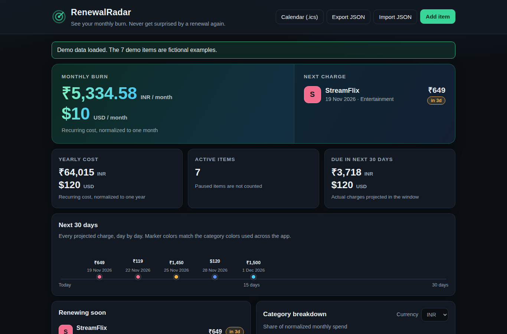

# RenewalRadar

[](https://github.com/RahilSahu/renewalradar/actions/workflows/ci.yml)
[](LICENSE)

A local-first subscription and bill tracker: see your monthly burn and never get surprised by a renewal again.

RenewalRadar tracks every recurring charge in one place: streaming, SaaS, utilities, insurance, domains, the gym. It shows what you actually spend per month once weekly, quarterly, and yearly bills are normalized, what is about to renew, and every charge coming in the next 90 days. There is no account and no server. Everything runs in your browser and your data never leaves your device.

**Live demo:** https://renewalradar-phi.vercel.app: click "Load demo data" to explore it with fictional items.



*The screenshot above is the real app running with the built-in fictional demo data.*

## Features

- Add, edit, and delete items with a name, amount, currency (INR, USD, EUR, GBP), billing cycle (weekly, monthly, quarterly, half-yearly, yearly, one-time), category, next renewal date, an optional payment label such as the card that gets charged, optional notes, and an active or paused status.
- Gradient hero card with your monthly burn in large type, animated with a count-up (static for reduced-motion users), and the next upcoming charge spotlighted beside it.
- Next 30 days timeline: every projected charge as a category-colored marker on a day-by-day strip.
- Dashboard stat cards: yearly cost normalized per currency (currencies are never mixed into one total), the active item count, and the amount actually due in the next 30 days, per currency.
- Renewing soon list with effective renewal dates: recurring items roll forward automatically, and badges flag overdue one-time items in red and anything due within 7 days in amber.
- Upcoming charges: every projected charge for the next 90 days, grouped by month with per-currency totals.
- Category breakdown as a color-coded bar chart of normalized monthly spend, with a currency switcher. Every category has one color, used consistently across tiles, chips, bars, and the timeline.
- Monogram tiles for every item, search, and category filter chips. Paused items are excluded from every total but stay listed, visually muted.
- Quick-add catalog: one click on Netflix, Spotify, YouTube Premium, Amazon Prime, Disney+ Hotstar, iCloud+, Google One, ChatGPT Plus, GitHub Copilot, Microsoft 365, Adobe Creative Cloud, Notion, House Rent, or Gym opens the add form prefilled with a typical price, clearly labeled so you replace it with what you actually pay.
- Empty state with one-click demo data (7 fictional items, a few with past payments) so you can see the dashboard before entering anything real.
- Export your data to JSON and import it back, with strict validation and a clear error if a file is bad. A bad file never half-loads.
- Dark, responsive interface that stays readable and overflow-free from small phones (280 px) to desktop.

## Automation, still 100 percent local

RenewalRadar has no server and no background process, so the automation is built from things your browser and calendar can do on their own:

- **Statement import with recurring-charge detection.** Drop in a bank statement CSV (HDFC, SBI, ICICI, and Axis export shapes are recognized, along with generic Debit or Amount plus Dr/Cr layouts). The file is parsed in your browser and never uploaded. Money-out rows are grouped by merchant after stripping reference numbers and channel prefixes like UPI and POS, amounts are clustered within 2 percent, and the billing rhythm is inferred from the median gap between charges. Anything that looks like a subscription is shown in a review list with editable name, amount, cycle, and next date, plus an "already tracked" flag when you track it already. Nothing is added until you confirm. Honest limits: detection needs at least 2 past charges for a merchant, works on CSV exports only (not PDF or screenshots), and can miss merchants whose names or amounts change between charges.
- **Mark as renewed.** One click records the payment in the item's history (date and amount, both editable in the confirm step), rolls the next renewal forward to the first occurrence after today, and, when the amount you actually paid differs from the tracked price, updates the tracked price and shows a price-changed note. Each item expands to show its payment history, most recent first.
- **Calendar reminders (.ics).** The Calendar (.ics) button generates a calendar file in your browser with one event per active subscription at its next renewal, repeating on the item's cycle, with an alarm 3 days before. Import it into Google Calendar, Apple Calendar, or Outlook and the reminders live in your calendar. There is no background process checking dates for you: the calendar file is the reminder mechanism.

Items saved by v1.0 load unchanged: the only data change in v1.1 is a new payment history list on each item, which starts empty for anything tracked before.

## Privacy

RenewalRadar is local-first by design:

- All data is stored in your browser's localStorage, on your device only.
- There is no backend, no account, no analytics, and the page makes no network requests after it loads.
- Export and import happen entirely on your device.

Two consequences worth knowing: clearing your browser's site data deletes your tracker, so export a backup now and then; and anyone with access to your browser profile can see the data, so do not put passwords or card numbers in the notes field. See [SECURITY.md](SECURITY.md) for the full model.

## Run it locally

No build step and no dependencies. Any static file server works:

```bash
git clone https://github.com/RahilSahu/renewalradar.git
cd renewalradar
python3 -m http.server 8000
# then open http://localhost:8000
```

Opening `index.html` directly from disk also works in most browsers.

## Usage

1. Click **Add item** and enter the subscription or bill: what it costs, how often it renews, and the next renewal date.
2. The dashboard updates immediately: burn rate at the top, renewals sorted by urgency, and a 90 day lookahead of charges.
3. Pause items you have cancelled but want to keep a record of. They stop counting toward every total.
4. Use **Export JSON** for backups and **Import JSON** to restore or move to another browser. Imports replace the current items after a confirmation, and only after the whole file validates.

## Development

All logic lives in `core.js` as pure functions (date and cycle math with month-end clamping and leap years, renewal projection, per-currency totals, validation). It runs in the browser as `window.RenewalCore` and in Node via `module.exports`, so the test suite exercises the exact code the UI ships. `app.js` is DOM and storage only.

```bash
npm test   # node --test, no dependencies to install
```

The suite currently has 73 tests covering cycle stepping (including Jan 31 clamping and Feb 29 yearly renewals), normalization factors, effective-next rolling, 90 day occurrence generation, per-currency totals with paused and one-time items, days-left and badge boundaries, filtering, breakdown shares, validation failures, payment history and the v1 data migration, mark-as-renewed rolling and price changes, CSV parsing and statement header families, merchant normalization, amount clustering, cadence inference, end-to-end detection from a fixture statement, and calendar (.ics) generation.

## Project structure

```
index.html              page markup
styles.css              dark theme, responsive to 280 px
core.js                 pure logic, shared by the UI and the tests
app.js                  DOM rendering and localStorage state
tests/core.test.js      node:test suite for dates, totals, and validation
tests/automation.test.js  node:test suite for history, detection, and ICS
tests/fixtures/         sample bank statement CSV used by the tests
```

## Roadmap

Honest future ideas, none of which are in v1.1.0:

- Per-item reminder offsets in the calendar export (the alarm is currently fixed at 3 days before).
- Multiple named lists (personal, family, business) in one browser.
- A yearly calendar view of charges.

## License

MIT. See [LICENSE](LICENSE).
